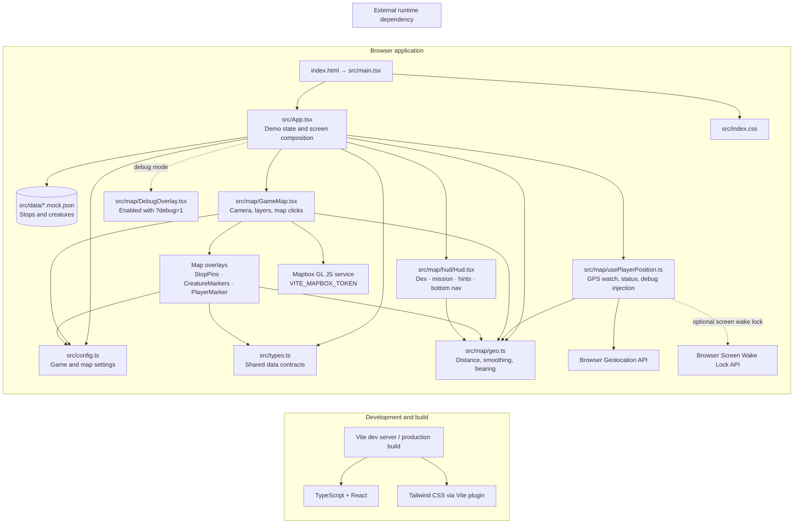

# UB Campus Dash architecture

This diagram describes the code currently present in this repository. It is a browser-only demo with mock JSON data; there is no server, API, database, or persistent game store in the checked-in application.

## Runtime data flow

1. `main.tsx` mounts `App` under React `StrictMode` and loads Mapbox and app CSS.
2. `App` imports the mock stop and creature arrays. It owns the demo collection list, hint level, messages, timer, and debug teleport toggle.
3. `usePlayerPosition` watches browser GPS, filters inaccurate fixes, smooths accepted coordinates with helpers from `geo.ts`, and reports status and off-campus state. In debug mode, tapping the map can inject a fix through this same hook.
4. `App` computes the next uncollected stop and distance to it, then passes state and callbacks to `GameMap` and the HUD.
5. `GameMap` renders the Mapbox basemap, stop/creature/player markers, catch-radius ring, camera behavior, and map controls. `StopPins`, `CreatureMarkers`, and `PlayerMarker` are presentational map overlays.
6. `Hud.tsx` renders the progress, mission, hint, and navigation UI. Collection and creature taps update only in-memory demo state.

## Main external requirements

- Set `VITE_MAPBOX_TOKEN` in a local `.env` file for the map to render.
- Browser location permission is needed to obtain live GPS fixes. Screen Wake Lock is optional and used only when available.
- `mapbox-gl`, `react-map-gl`, React, and Turf distance utilities are runtime dependencies. Vite, TypeScript, Vitest, and ESLint support local development and build tooling.

## Repository boundary

The checked-in entry screen labels itself a temporary map demo. Although shared types include phases and the creature model includes quiz fields, this screen does not implement a production game flow, server integration, persistent storage, or navigation between distinct screens.
